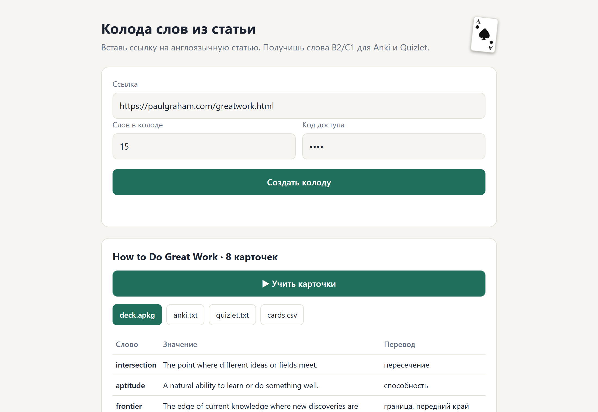
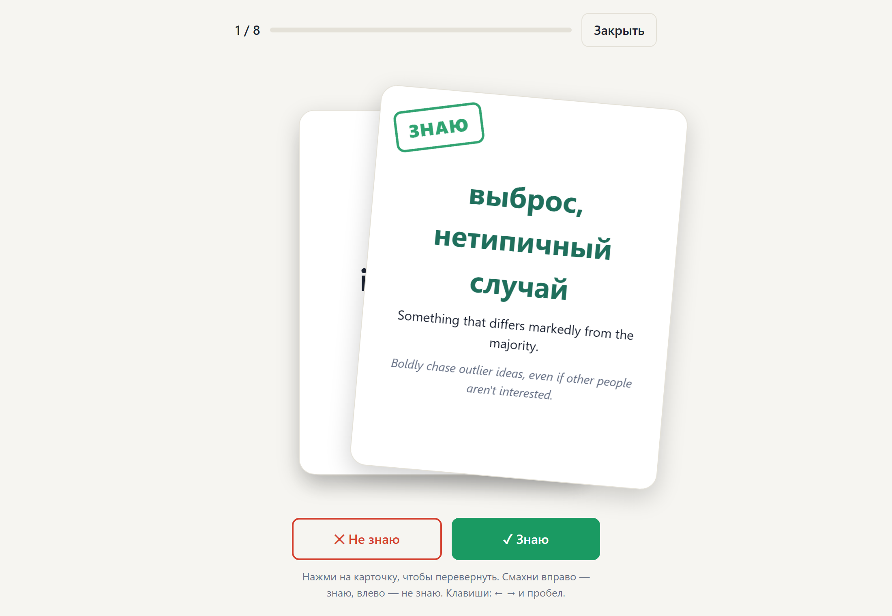
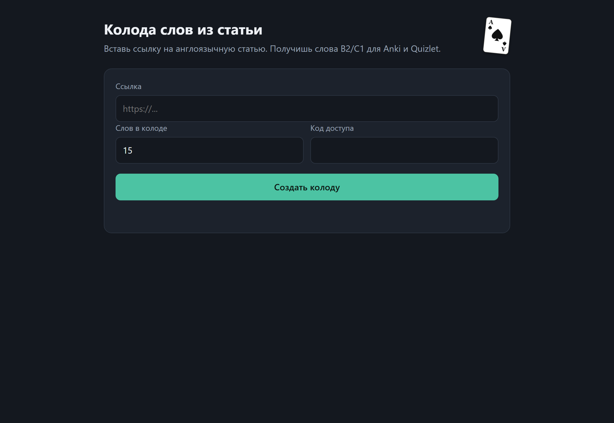
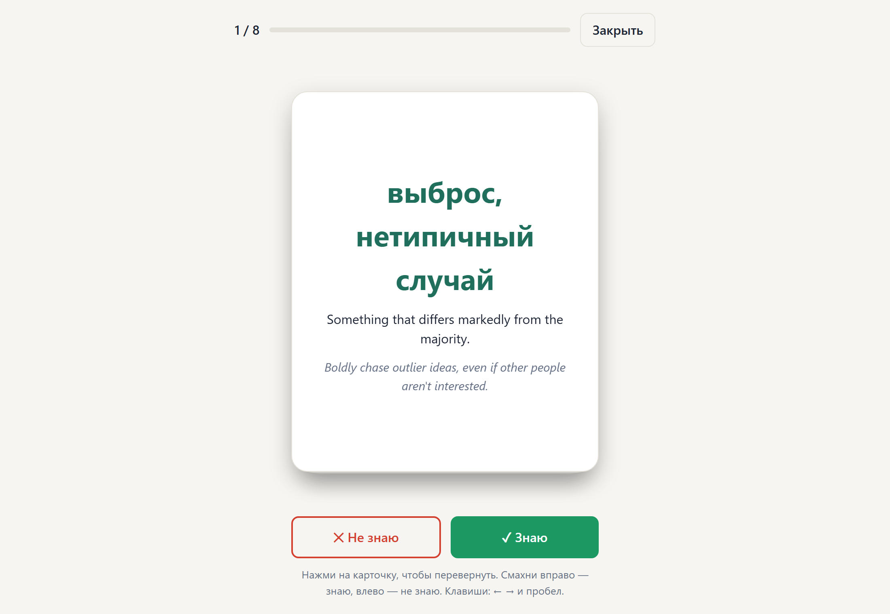
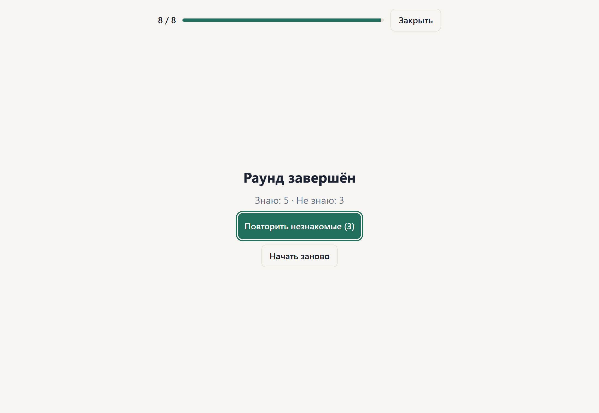
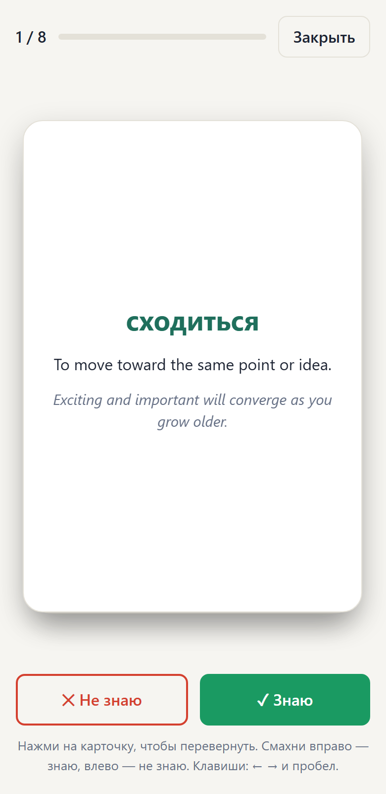

# Vocab Deck Generator

Paste a link to any English article and get a ready-to-study flashcard deck of 15 B2/C1 words in about 20 seconds: English definition, Russian translation, an example sentence and an image prompt for every word.

Built for English teachers who spend an hour a week hand-picking vocabulary from articles. Use it from a **Telegram bot**, a **web page**, or an **automation scenario in Make.com**.

*Русская версия документации: [README.ru.md](README.ru.md). Plain-language explanation for non-programmers: [КАК_ЭТО_РАБОТАЕТ.md](КАК_ЭТО_РАБОТАЕТ.md).*

<p align="center">
  
  
</p>

## Features

- **Article to deck.** Extracts the main text of a page (no menus, ads or comments) and asks an LLM for words that are genuinely B2/C1, not "figure out" or "take action".
- **Study mode in the browser.** Physical-feeling flashcards: tap to flip and see the Russian translation, swipe right for "know", left for "don't know". Progress bar, repeat-the-unknown rounds, keyboard shortcuts, text-to-speech for the English word.
- **Exports.** Anki `.apkg` (double-click to import), Anki CSV, Quizlet import text, and a full CSV with every field.
- **Three front doors, one engine.** Telegram bot, web form, and a JSON API that a Make.com scenario calls.
- **Light and dark themes, mobile layout, reduced-motion support.** Plus a small easter egg: the ace of spades in the corner.

| | |
|---|---|
|  |  |
|  |  |

## How it works

```
Telegram ──► Make.com ──► POST /api/generate ──► LLM (Groq, OpenAI-compatible)
Web form ──────────────────────┘      │
                                      ├─ trafilatura: article text
                                      └─ genanki: .apkg, plus CSV builders
```

1. `app/extractor.py` downloads the page and extracts the article text.
2. `app/llm.py` prompts the model, validates the JSON with Pydantic, removes duplicates and asks for more words if the model returned too few.
3. `app/deck.py` builds the Anki package and the text exports.
4. `app/main.py` exposes everything through FastAPI; `app/static/index.html` is the whole front end (no build step, no framework).
5. `bot.py` is a standalone Telegram bot that uses the same pipeline.

## Tech stack

Python 3.12, FastAPI, Pydantic, httpx, trafilatura, genanki, vanilla JS/CSS (Pointer Events for swipes, CSS 3D transforms for card flips), Docker, Render, Make.com, Telegram Bot API. 15 automated tests (pytest).

## Engineering notes

Problems met on the way and how they were solved:

- **LLM returns fewer items than requested.** The model kept returning 10 words instead of 15. The service now over-asks, de-duplicates and runs follow-up requests that list the words already chosen, up to a limit.
- **Word quality.** The first prompt produced B1 words. Rejecting examples inside the prompt and asking for single advanced words and less common collocations fixed it.
- **Free LLM tiers change.** Gemini models disappeared for new users and a Groq model was retired during development. The provider is therefore pluggable: any OpenAI-compatible endpoint works through environment variables.
- **SSRF protection.** The service fetches user-supplied URLs, so every address (including each redirect hop) is resolved and rejected if it is not a public IP.
- **Sites that block bots.** Some sites need a browser User-Agent and others (Wikipedia) a descriptive bot one. The fetcher tries both on a 403.
- **Abuse limits.** API key with constant-time comparison, a global hourly limit, per-user limits in the bot, and a lockout after repeated wrong keys.
- **Untrusted article text.** The article is passed to the model as data with an explicit instruction to ignore instructions inside it, and the output is schema-validated before use. All card text is rendered with `textContent`, never `innerHTML`.

## Known limitations

- YouTube transcripts are implemented but YouTube blocks most server and home IPs, so it is effectively unavailable.
- Paywalled pages and Wikipedia cannot be read.
- Image prompts are generated but images are not.
- The free Render tier sleeps; the first request after idle takes about a minute.

## Run it locally

```bash
python -m venv .venv
.venv\Scripts\activate          # macOS/Linux: source .venv/bin/activate
pip install -r requirements.txt
cp .env.example .env            # then fill in the values below
uvicorn app.main:app --port 8000   # web page and API on http://localhost:8000
python bot.py                      # optional: Telegram bot
python -m pytest
```

| Variable | Meaning |
|---|---|
| `LLM_PROVIDER` | `gemini` or `openai_compatible` |
| `LLM_API_KEY`, `LLM_BASE_URL`, `LLM_MODEL` | Any OpenAI-compatible provider, for example Groq (`https://api.groq.com/openai/v1`) |
| `SERVICE_API_KEY` | Access code for the web page and the API |
| `TELEGRAM_BOT_TOKEN`, `TELEGRAM_ALLOWED_IDS` | Bot token from @BotFather and the allowed teacher ids |

Deployment (`Dockerfile`, `render.yaml`) and the Make.com scenario steps are described in [README.ru.md](README.ru.md).

## License

MIT, see [LICENSE](LICENSE).
