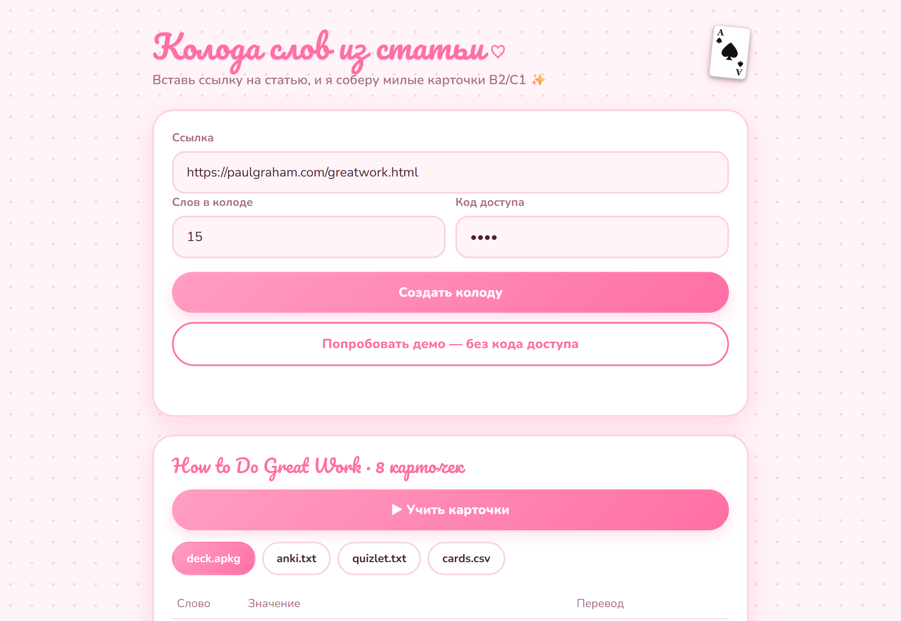
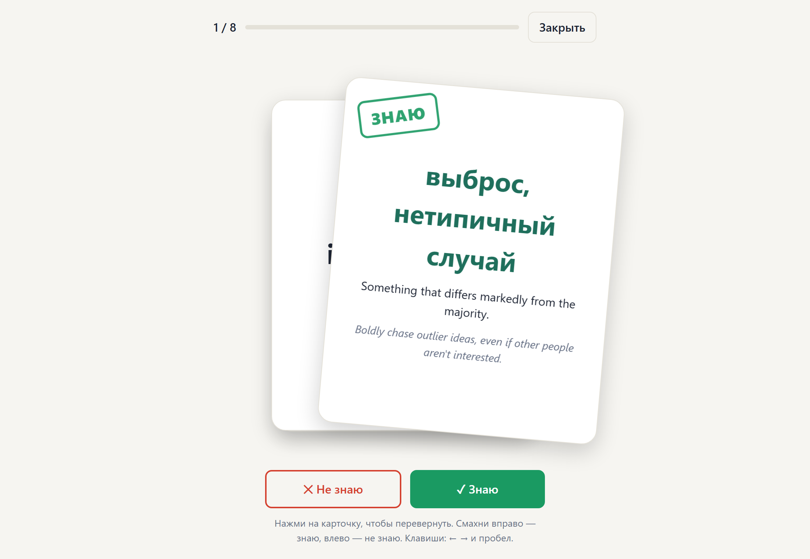
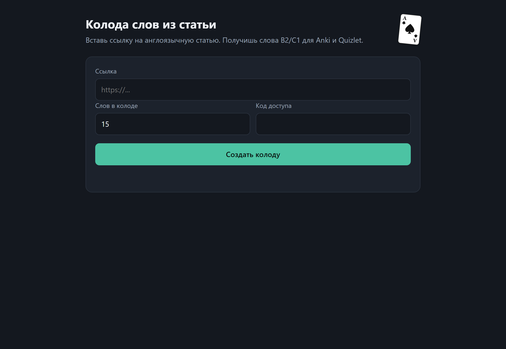
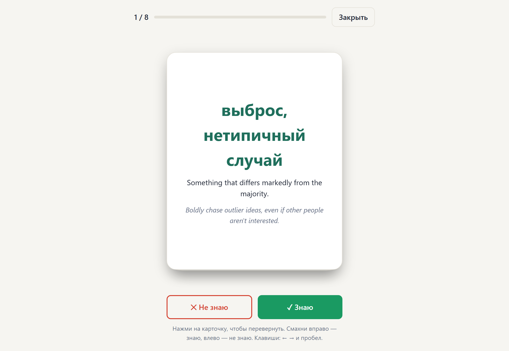
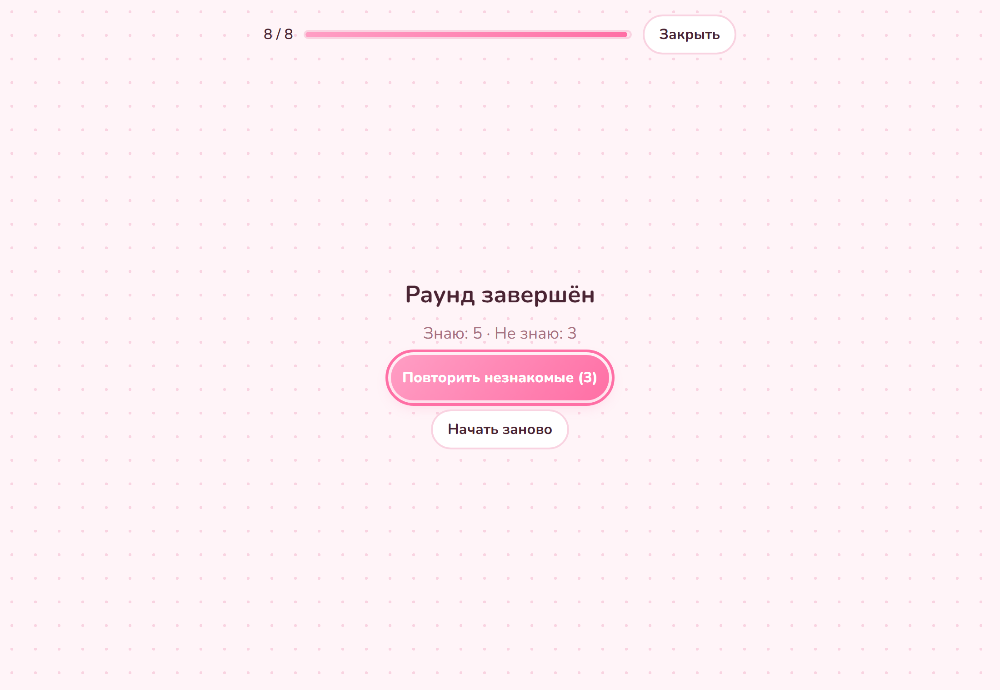
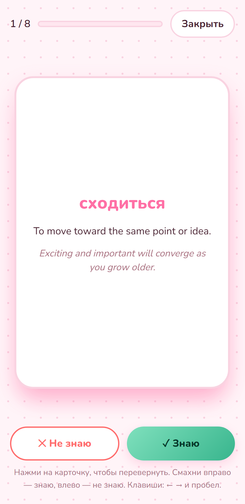

# Vocab Deck Generator ♡

**Paste a link to an English article, get a ready-to-study flashcard deck of B2/C1 words in about 20 seconds.**
Every card has an English definition, a Russian translation, an example sentence and an image prompt. Study the deck right in the browser with Quizlet-style swipe cards, or export it to Anki and Quizlet.

[](#tech-stack)
[](#tech-stack)
[](#tech-stack)
[](#tests)
[](LICENSE)

### 🔗 [Live demo](https://vocab-deck-api.onrender.com) · press **“Попробовать демо”** (no sign-up, no code needed)

*The first load can take up to a minute: the free hosting sleeps when idle.*

<p align="center">
  
  
</p>

*Русская версия: [README.ru.md](README.ru.md) · Кейс для портфолио: [docs/КЕЙС.md](docs/КЕЙС.md) · Объяснение для не-программистов: [КАК_ЭТО_РАБОТАЕТ.md](КАК_ЭТО_РАБОТАЕТ.md)*

## The problem

English teachers spend a lot of time reading articles and hand-picking vocabulary for students: choosing the right words, writing definitions in context, finding translations and examples, and typing it all into Anki or Quizlet. This tool does that selection and formatting automatically, so the teacher only chooses the article.

## Features

- **Article to deck.** Extracts the main text of a page (no menus, ads or comments) and asks an LLM for words that are genuinely B2/C1, not "figure out" or "take action".
- **Study mode in the browser.** Physical-feeling cards: tap to flip and see the Russian translation, swipe right for "know", left for "don't know". Progress bar, repeat-the-unknown rounds, keyboard shortcuts, text-to-speech for the English word.
- **Exports.** Anki `.apkg` (double-click to import), Anki CSV, Quizlet import text, and a full CSV with every field.
- **Three front doors, one engine.** A Telegram bot, a web page, and a JSON API that a Make.com scenario can call.
- **One-click demo.** A pre-generated deck (`app/static/demo.json`) loads with no access code and no LLM call, so visitors can try the study mode even when the free hosting is asleep.
- **Pink and white theme with a light/dark switch,** mobile layout, reduced-motion support, and a small easter egg: the ace of spades in the corner.

| | |
|---|---|
|  |  |
|  |  |

## How it works

```
Telegram ──webhook──► POST /telegram/webhook ─┐
Web page ───────────► POST /api/generate ─────┤
Make.com ───────────► POST /api/generate ─────┤
                                              ▼
                              ┌─ extractor: download page, extract article text (trafilatura)
                              ├─ llm: prompt model, validate JSON (Pydantic), dedupe, top-up missing words
                              └─ deck: Anki .apkg (genanki), Anki CSV, Quizlet text, full CSV
```

1. `app/extractor.py` downloads the page and extracts the article text.
2. `app/llm.py` prompts the model, validates the JSON with Pydantic, removes duplicates and asks for more words if the model returned too few.
3. `app/deck.py` builds the Anki package and the text exports.
4. `app/main.py` exposes everything through FastAPI; `app/static/index.html` is the whole front end (no build step, no framework).
5. `app/tg.py` is the Telegram bot logic, shared by the server webhook and the local polling script `bot.py`.

## Tech stack

| Area | Tools | What it is used for |
|---|---|---|
| Language | **Python 3.12** | Everything on the server side |
| API | **FastAPI**, Uvicorn, Pydantic (+ pydantic-settings) | HTTP API, request validation, typed settings from environment variables |
| Article extraction | **trafilatura**, httpx | Download pages and keep only the article text |
| AI | **Groq** (`openai/gpt-oss-120b`) through an OpenAI-compatible API; Gemini adapter included | Pick B2/C1 words and write definitions, translations, examples, image prompts as JSON |
| Export | **genanki**, csv | Real Anki `.apkg` packages plus Anki, Quizlet and Excel exports |
| Telegram | **Telegram Bot API** (webhook and long polling) | Bot interface; webhook authenticated with a secret-token header |
| Front end | Vanilla **HTML / CSS / JS**, SVG, Pointer Events, CSS 3D transforms, Web Speech API | Swipe flashcards, flip animation, themes, text-to-speech. Fonts: Nunito, Pacifico |
| Automation | **Make.com** (scenario documented in `README.ru.md`) | Optional no-code front door that calls `/api/generate` |
| DevOps | **Docker**, **Render** (Blueprint via `render.yaml`), GitHub | Containerized deploy from the repository |
| Quality | **pytest** (18 tests), **Playwright** | Unit and API tests; browser checks and the screenshots in `docs/` |

## Engineering notes

Problems met on the way and how they were solved:

- **LLM returns fewer items than requested.** The model kept returning 10 words instead of 15. The service now over-asks, de-duplicates and runs follow-up requests that list the words already chosen, up to a limit.
- **Word quality.** The first prompt produced B1 words. Rejecting examples inside the prompt and asking for single advanced words and less common collocations fixed it.
- **Free LLM tiers change.** Gemini models disappeared for new users and a Groq model was retired during development. The provider is therefore pluggable: any OpenAI-compatible endpoint works through environment variables.
- **SSRF protection.** The service fetches user-supplied URLs, so every address (including each redirect hop) is resolved and rejected if it is not a public IP.
- **Sites that block bots.** Some sites need a browser User-Agent and others (Wikipedia) a descriptive bot one. The fetcher tries both on a 403.
- **Abuse limits.** API key with constant-time comparison, a global hourly limit, per-user limits in the bot, a lockout after repeated wrong keys, and an allow-list of Telegram ids.
- **Webhook on a free host.** The Telegram webhook answers immediately and builds the deck in a background task. Duplicate deliveries are ignored, and the request is checked against a secret derived from the bot token.
- **Untrusted article text.** The article is passed to the model as data with an explicit instruction to ignore instructions inside it, and the output is schema-validated before use. All card text is rendered with `textContent`, never `innerHTML`.

## Known limitations

- YouTube transcripts are implemented but YouTube blocks most server and home IPs, so it is effectively unavailable.
- Paywalled pages and Wikipedia cannot be read.
- Image prompts are generated but images are not.
- The free Render tier sleeps; the first request after idle takes about a minute.

## Run it locally

```bash
python -m venv .venv
.venv\Scripts\activate          # macOS/Linux: source .venv/bin/activate
pip install -r requirements.txt
cp .env.example .env            # then fill in the values below
uvicorn app.main:app --port 8000   # web page and API on http://localhost:8000
python bot.py                      # optional: Telegram bot (local polling)
python -m pytest
```

| Variable | Meaning |
|---|---|
| `LLM_PROVIDER` | `gemini` or `openai_compatible` |
| `LLM_API_KEY`, `LLM_BASE_URL`, `LLM_MODEL` | Any OpenAI-compatible provider, for example Groq (`https://api.groq.com/openai/v1`) |
| `SERVICE_API_KEY` | Access code for the web page and the API |
| `TELEGRAM_BOT_TOKEN`, `TELEGRAM_ALLOWED_IDS` | Bot token from @BotFather and the allowed Telegram ids |
| `TELEGRAM_WEBHOOK` | `true` on the server so the bot receives messages by webhook |

## Running the bot without your laptop

Two ways, pick one (Telegram delivers messages to a single receiver):

- **Webhook inside the service (default on Render).** With `TELEGRAM_WEBHOOK=true` the service registers `POST /telegram/webhook` with Telegram on startup (the public URL comes from Render's `RENDER_EXTERNAL_URL`).
- **Make.com scenario.** Set `TELEGRAM_WEBHOOK=false` and let Make receive the messages and call `POST /api/generate`.

`python bot.py` is a local polling mode for development; stop it before enabling the webhook.
On the free Render tier the first message after a quiet period can take about a minute; a free uptime pinger on `/api/health` keeps the service awake.

Deployment (`Dockerfile`, `render.yaml`) and the Make.com scenario steps are described in [README.ru.md](README.ru.md).

## Tests

```bash
python -m pytest        # 18 tests: exports, .apkg validity, SSRF guards, auth and rate limits, webhook security, LLM retries
```

## Author

Made by **Damir** ([@dam1r-dev](https://github.com/dam1r-dev)). Built with AI-assisted development (Claude Code).

## License

MIT, see [LICENSE](LICENSE).
