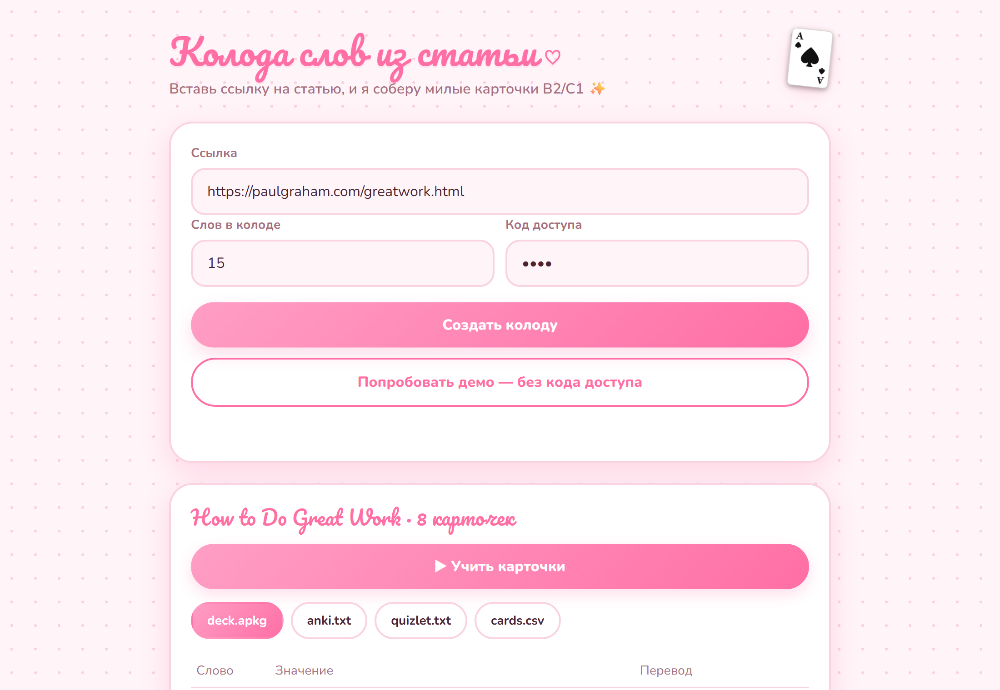
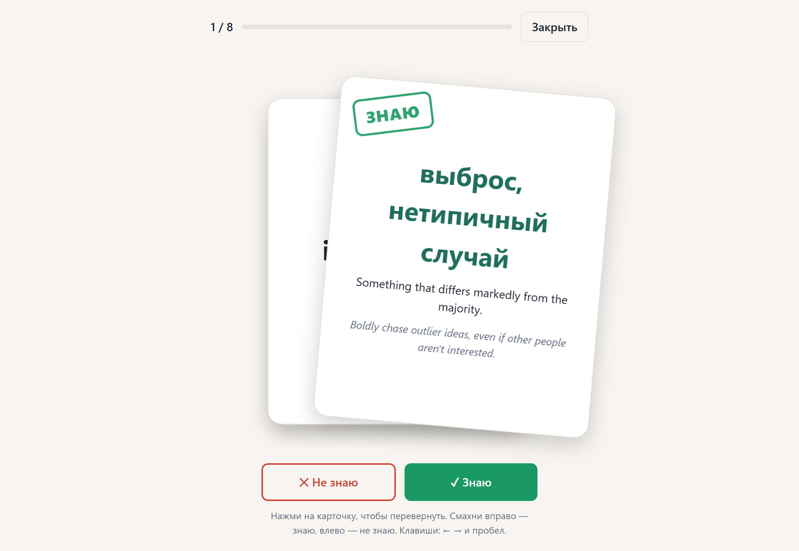
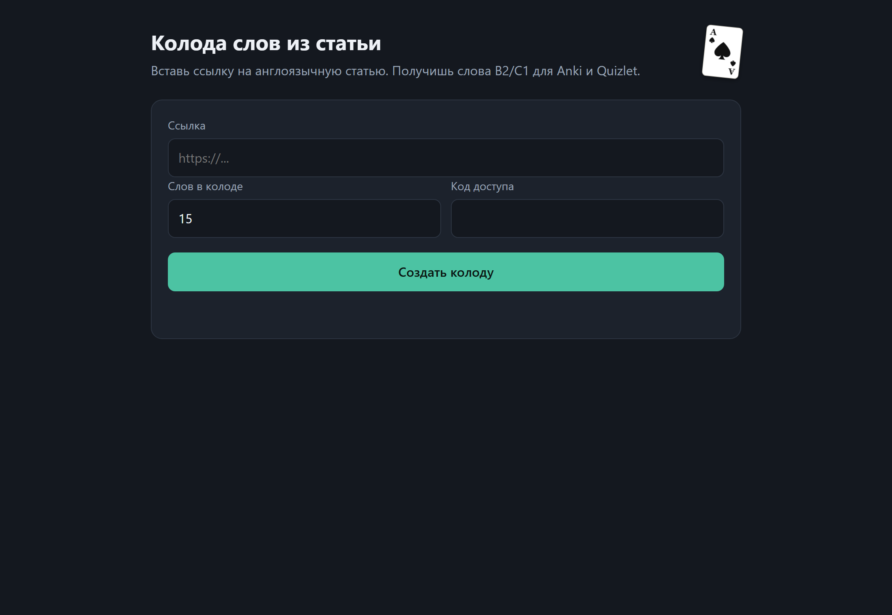
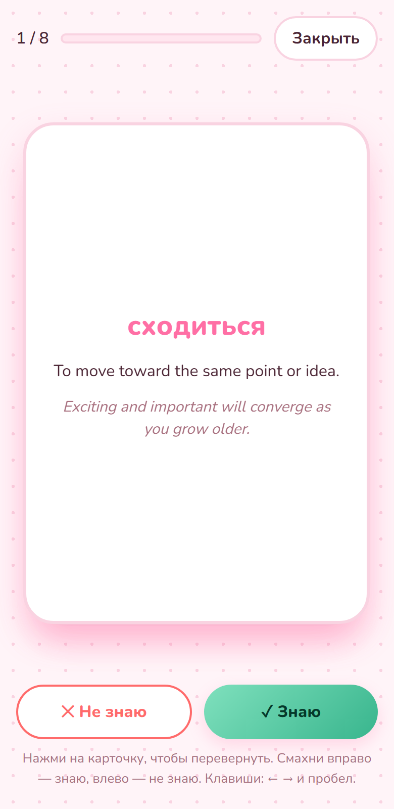

# Кейс: генератор карточек для изучения английского

> Вставляешь ссылку на статью, через ~20 секунд получаешь колоду слов B2/C1 с переводом и примерами. Учишь прямо на сайте, как в Quizlet, или забираешь в Anki.

**Живая демо-версия:** https://vocab-deck-api.onrender.com (кнопка «Попробовать демо» работает без регистрации)
**Код:** https://github.com/dam1r-dev/vocab-deck-generator
**Автор:** Damir · **Тип:** личный проект, full-stack (бэкенд + интерфейс + бот + деплой)

## Задача

Учителям английского приходится вручную читать статьи, выбирать слова для учеников, писать определения и переводы, подбирать примеры и вносить всё это в Anki или Quizlet. Это долго и однообразно. Нужен был инструмент, где учитель присылает только ссылку и сразу получает готовую колоду.

## Решение

Сервис, который:
1. скачивает страницу и вытаскивает из неё только текст статьи;
2. просит нейросеть выбрать слова уровня B2/C1 и подготовить для каждого определение на английском, русский перевод, пример и описание картинки;
3. проверяет ответ (структура, дубликаты, нужное количество слов) и собирает файлы;
4. отдаёт результат тремя способами: через Telegram-бота, веб-страницу и API.

| Режим карточек | Тёмная тема | Телефон |
|---|---|---|
|  |  |  |

## Что умеет

- **Карточки как настоящие.** Нажал, и карточка перевернулась: видно русский перевод, определение и пример. Смахнул вправо означает «знаю», влево «не знаю». После раунда можно повторить только незнакомые слова.
- **Экспорт:** Anki (`.apkg` открывается двойным кликом), CSV для Anki, текст для импорта в Quizlet, полный CSV.
- **Telegram-бот** принимает ссылку и присылает все файлы в чат. Работает на сервере через webhook, ноутбук не нужен.
- **Демо без кода доступа:** готовая колода открывается мгновенно и не тратит лимиты нейросети.
- Светлая и тёмная тема, адаптивный интерфейс, озвучка английского слова, пасхалка с тузом пик.

## Стек и зачем что использовалось

| Область | Технологии | Для чего |
|---|---|---|
| Бэкенд | Python 3.12, FastAPI, Pydantic, httpx | API, проверка данных, настройки из окружения |
| Текст статьи | trafilatura | Достаёт чистый текст без меню и рекламы |
| ИИ | Groq (`gpt-oss-120b`), OpenAI-совместимый API; адаптер Gemini | Подбор слов и написание карточек в формате JSON |
| Экспорт | genanki, csv | Настоящий пакет Anki и текстовые форматы |
| Бот | Telegram Bot API (webhook) | Приём ссылок, отправка файлов |
| Интерфейс | HTML, CSS, JavaScript без фреймворков, SVG, Pointer Events, CSS 3D, Web Speech API | Свайпы, переворот карточки, темы, озвучка |
| Автоматизация | Make.com (сценарий описан в документации) | Альтернативный вход без кода |
| Деплой | Docker, Render (`render.yaml`), GitHub | Публикация из репозитория |
| Качество | pytest (18 тестов), Playwright | Автотесты и проверка интерфейса в браузере |

## Сложности и как их решил

- **Нейросеть возвращала 10 слов вместо 15.** Сервис просит с запасом, убирает повторы и дозапрашивает недостающие слова, передавая список уже выбранных.
- **Попадались слишком простые слова** (*figure out*, *take action*). Переписал задание для модели: запретил примеры B1 и попросил сложные одиночные слова и нетривиальные словосочетания. Результат стал заметно сложнее и полезнее.
- **Бесплатные модели исчезают.** За время разработки пропали модели у Gemini и Groq. Сделал подключаемого провайдера: подойдёт любой OpenAI-совместимый сервис, меняется через переменные окружения.
- **Безопасность.** Сервис открывает ссылки пользователей, поэтому каждый адрес (и каждый редирект) проверяется: внутренние адреса запрещены (защита от SSRF). Есть код доступа, лимиты запросов, блокировка подбора пароля, список разрешённых пользователей бота, проверка секрета webhook. Текст статьи считается недоверенным: он передаётся ИИ как данные, ответ проверяется по схеме, а в интерфейсе выводится без HTML.
- **Сайты, блокирующие ботов.** Одним нужен браузерный User-Agent, другим (Wikipedia) честный бот-идентификатор. Загрузчик пробует оба варианта.
- **Бот на бесплатном хостинге.** Webhook отвечает сразу, а колода собирается в фоне. Повторные доставки Telegram игнорируются.

## Результат

- Рабочий продукт в интернете: сайт, Telegram-бот и API на одном сервисе.
- Колода из 15 слов собирается примерно за 20–30 секунд.
- 18 автоматических тестов, публичный репозиторий с документацией на английском и русском, скриншотами и инструкцией запуска.

## Что бы доработал дальше

- Генерацию картинок по готовым промптам (сейчас промпт попадает в карточку, а картинка нет).
- Поддержку видео YouTube (код есть, но YouTube блокирует запросы с серверов).
- Свой аккаунт и сохранение колод, повторение с интервалами.

## О процессе

Проект сделан с помощью AI-ассистента (Claude Code): я ставил задачи и принимал решения по продукту, архитектуре и дизайну, проверял результат в браузере и на телефоне, настраивал деплой и аккаунты.
